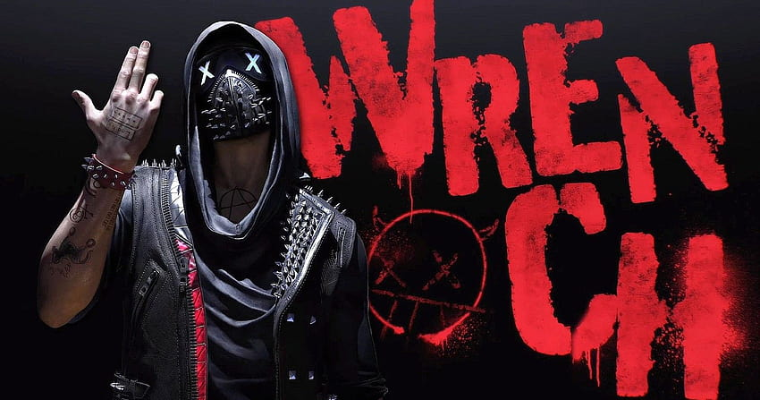

<div align="center">

# AYMAN / WRENCH



<br><br>


<br>

<a href="https://ayman.mohammed-mahdi.workers.dev/en"></a>
<a href="https://www.linkedin.com/in/mahdi-mohammed-ayman/"></a>
<a href="mailto:mahdi.medayman@gmail.com"></a>


**Casablanca, Morocco · العربية / Français / English**

</div>

---

### `~/ayman — whoami`

```typescript
const ayman = {
  name: "Mahdi Mohammed Ayman",
  role: "Junior Software Developer",
  background: "Computer & Network Engineering · EMSI",
  location: "Casablanca, Morocco",

  building: ["Web applications", "Mobile experiences", "AI integrations"],
  currently: "Rideline — a community for motorcycle riders",
  offline: ["Motorcycles", "Music", "Writing", "Gaming"],

  mindset: "Understand it. Build it. Test it. Make it better."
};
```

I like building things that connect: interfaces to services, ideas to working applications, and people to communities.

My work spans web and mobile development, backend APIs, document workflows, and practical AI features. I use AI coding tools in my workflow and explain the collaboration and my contribution in my project case studies.

**Open to junior software roles and international relocation.**

### `~/toolbox — ls`

<div align="center">

**WEB & MOBILE**


React Native · Expo

<br><br>

**BACKEND & DATA**


Hono · REST APIs · SQLite

<br><br>

**TOOLS & CLOUD**


</div>

### `~/projects — open`

<table>
<tr>
<td width="50%" valign="top">

### 🏍️ Rideline

**Your bikes. Your roads. Your riding circle.**

My personal motorcycle community project: profiles, garages, messaging, clubs, meetings, motorcycle care, and foreground ride recording.

Product and UX direction by me, developed with substantial Codex assistance.

`React Native` `Expo` `TypeScript` `Supabase` `Cloudflare`

**🚧 In development**

[Case study ↗](https://ayman.mohammed-mahdi.workers.dev/en/projects/rideline) · [Web preview ↗](https://rideline-web-dev.mohammed-mahdi.workers.dev/)

</td>
<td width="50%" valign="top">

### 🌍 Visa Solutions

A student visa management platform connecting guided document uploads, administrative validation, university recommendations, and an assistance chatbot.

Built during my software engineering internship and final-year project.

`Next.js` `FastAPI` `Flutter` `PostgreSQL` `Ollama`

[Case study ↗](https://ayman.mohammed-mahdi.workers.dev/en/projects/student-visa-platform)

</td>
</tr>
<tr>
<td width="50%" valign="top">

### 🔗 WRX Generator V2

A co-developed academic project bringing short links, QR codes, password generation, analytics, and subscription workflows into one workspace.

`React` `TypeScript` `NestJS` `Supabase` `Stripe`

[Case study ↗](https://ayman.mohammed-mahdi.workers.dev/en/projects/wrx-generator-v2)

</td>
<td width="50%" valign="top">

### 💪 WRX Workout

A mobile fitness experience with daily activity tracking, adaptive quests, an AI coach, and offline storage.

`Flutter` `Firebase` `Hive` `OpenRouter`

[Case study ↗](https://ayman.mohammed-mahdi.workers.dev/en/projects/wrx-workout)

</td>
</tr>
</table>

### `~/off-duty — beyond-the-code`


🏍️ **Rider** — mountain roads and trips with friends.

🎧 **WRENCH** — the name behind my music.

📖 **The Shape of Love** — my philosophical exploration of how our attachments shape us.

🎮 **Gaming** — another place you’ll find WRENCH.

[Open “Beyond the code” ↗](https://ayman.mohammed-mahdi.workers.dev/en?app=hobbies)

<br clear="both">

---

<div align="center">

### Got something interesting to build?

[Send me a message](mailto:mahdi.medayman@gmail.com) · [Explore Ayman OS](https://ayman.mohammed-mahdi.workers.dev/en)

**Code. Ride. Create. Repeat.**

</div>
